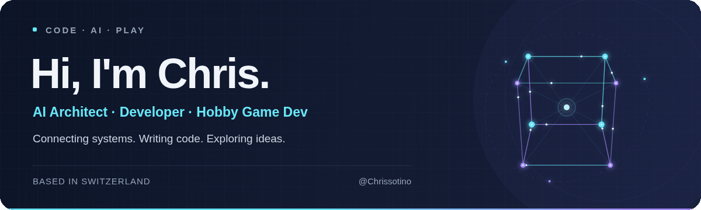

  

  
  

## 👋 From architecture to code

I'm **Chris**, an **AI Architect and developer based in Switzerland**. I design AI systems, build software across multiple languages, and connect applications through APIs, automation and agent workflows.

My work brings together **software development, AI architecture and enterprise integration**. I connect agents to tools and data with MCP and bring AI into existing business systems. My experience includes the Microsoft ecosystem alongside frameworks and tools such as LangChain, Docker, REST and GraphQL.

Outside of that work, I'm a **hobby game developer**, working with **Godot and Unreal Engine** and developing **mobile games with Swift and Kotlin**. Game development is my creative space for coding, experimenting and turning ideas into something interactive. 🎮

  

## ⚡ What I work on

| Area | Focus |
| :--- | :--- |
| **🤖 AI & agentic systems** | MCP architectures, tool-connected agents, multi-agent orchestration and intelligent automation. |
| **💻 Software & integrations** | Python and TypeScript development, REST and GraphQL APIs, and connections between services and data sources. |
| **🏗️ Enterprise architecture** | AI integration into existing infrastructure, scalable system design, and responsible AI strategy and governance. |
| **🎮 Games & mobile** | Hobby game development with Godot and Unreal Engine, plus mobile games using Swift and Kotlin. |

## 🧰 Languages, frameworks & platforms

  
  
  
  
  
  

  
  
  
  
  

| Field | Technologies & experience |
| :--- | :--- |
| **Programming languages** | Python · TypeScript · C# · Rust · Swift · Kotlin |
| **Game engines** | Godot · Unreal Engine |
| **APIs & integrations** | REST APIs · GraphQL |
| **AI & orchestration** | Model Context Protocol (MCP) · LangChain · Semantic Kernel · AutoGen · Azure OpenAI |
| **Containers & development tooling** | Docker · Azure DevOps |
| **Cloud & automation** | Azure AI Studio · Azure Functions · Azure Logic Apps · Power Platform |
| **Business platforms** | Microsoft Copilot Studio · Microsoft 365 Copilot · Dynamics 365 |

## 🔭 Currently exploring

- **Agent collaboration** → orchestration patterns and how agents share work through tools, APIs and context.
- **AI in everyday workflows** → connecting AI capabilities to the systems people already use.
- **Architecture into implementation** → translating AI concepts into maintainable software and enterprise integrations.
- **Game & mobile development** → exploring interactive ideas across game engines and mobile platforms.

## 🤝 Let's connect

Interested in **AI agents, software architecture, API integrations or game and mobile development**? I'm always happy to exchange ideas and talk tech.

**[Find me on LinkedIn →](https://www.linkedin.com/in/Chrissotino/)**
