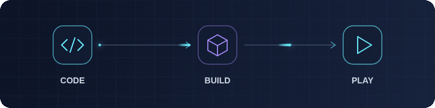

# Profile animations

Four matching GIFs in cyan and violet. Each loops continuously over 4.8 seconds at 20 frames per second. The banner text stays still while the network rotates.

| File | Size | Use |
| :--- | :--- | :--- |
| [profile-banner.gif](profile-banner.gif) | 1200 × 360 | Full profile header |
| [tech-network.gif](tech-network.gif) | 360 × 360 | Project intro, sidebar or standalone visual |
| [code-flow.gif](code-flow.gif) | 720 × 180 | Code → Build → Play section or project README |
| [tech-divider.gif](tech-divider.gif) | 1200 × 24 | Subtle section divider |

## Preview





## Reuse

Copy the desired GIF into the destination repository's `assets` folder. These examples assume the Markdown file is at the repository root:

```html


```

The GIFs contain all their frames and need no scripts or external image service. For a still profile header, use [profile-banner.svg](profile-banner.svg). GIF playback does not automatically respect reduced-motion preferences, so choose the still header when that matters for the destination.

## Regenerate

Requirements: Node.js, the `playwright` Node package, Chromium, FFmpeg with `palettegen` and `paletteuse`, and ImageMagick (`magick`). These are available in the current development environment.

From the repository root:

```sh
node scripts/generate-animations.cjs
```

The generator reads the static SVG banner and replaces only its network illustration with procedural animation. It writes the four GIFs above and cleans up temporary frames. It uses `/usr/bin/chromium` by default; set `CHROMIUM_PATH` if your executable is elsewhere.
